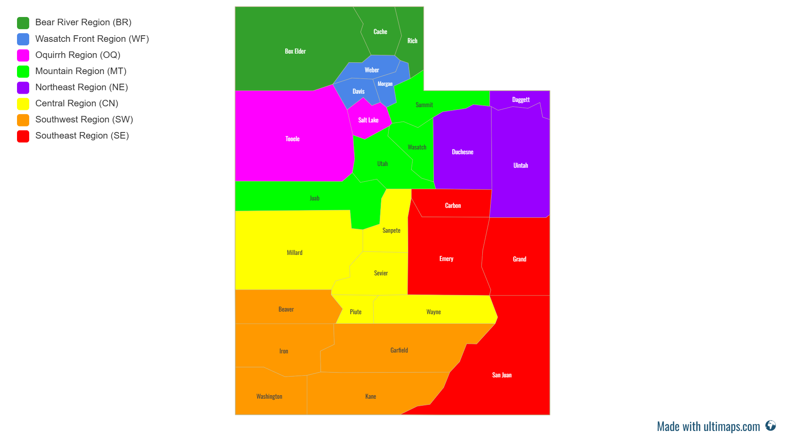
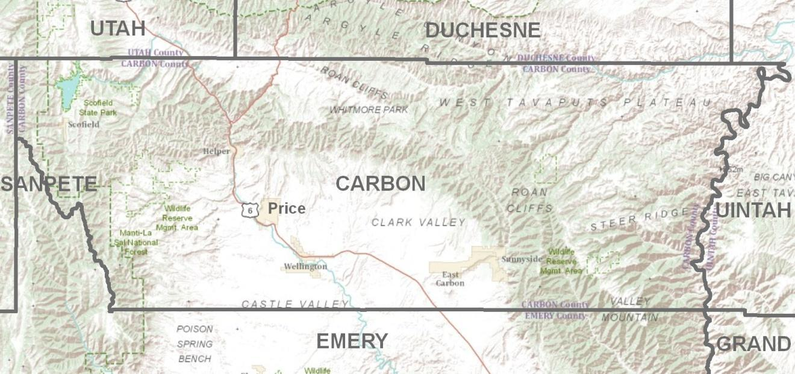
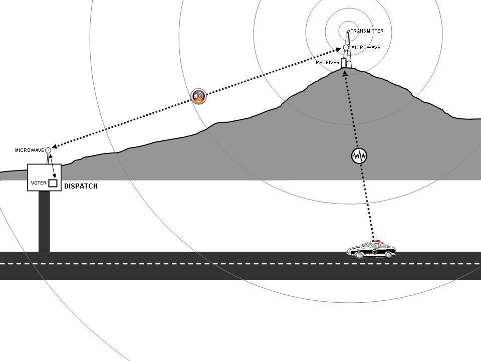

# Utah Interoperable Communications Field Operations Guide
## Version 4.0 — WORKING DRAFT (PRIVATE — CONTROLLED)

**Status:** Working draft, private. Controlled (CUI) — distribution
limited to authorized users. Not for publication and not for
distribution beyond authorized reviewers. Built from known information
on Oct 24, 2026; content is being filled in as it is confirmed.

**Cover (per approved draft):**
- Version 4.0 — January 2027 (planned)
- Authority: Statewide Interoperability Coordinator, under the
  direction of the Statewide Interoperability Executive Committee
- Published by: Statewide Interoperability Coordinator, Utah Division
  of Emergency Management, Department of Public Safety (DPS/DEM)
- Distribution: Controlled (CUI)
- Supersedes: Version 3.0 (November 2022)
- Marking: CUI replaces FOUO throughout (per SWIC direction, Oct 24)

**Section status:** Populated below = Utah Regions, 700 MHz Interop
Talkgroups and Channels (summary + companion file), Radio Template
Programming Requirements (carried forward from v3.0 — VERIFY, to be
updated by the SWIC over winter 2026-27), National Interoperability Channels (NIFOG) (CISA public source), Statewide Interop Channel Capabilities (Utah-specific), State Maps (regional maps), Gateways (TICP sources), Radio Caches (TICP sources), PSAP Information (2024 contact list), Interoperable Repeaters (TICP sources), Establishing Interoperability (State PACE Plan 2026), Federal Interoperability Channel Plan (FED_OPS + federal programs), Communications Unit (COMU) (ESF #2 vs COML + positions). All other sections
from the v3.0 table of contents remain placeholders pending content
review: Introduction, Interoperability and Incident Management, Requests for Communications Assets, Nationwide Interop Channel
Capabilities, Transportable Repeaters, Data
Communications Devices.

---

## Utah Regions (POPULATED — Oct 24, 2026)

Updated from the seven Homeland Security Regions in v3.0 to the
current eight-region structure:

| Code | Region | Counties |
|------|--------|----------|
| BR | Bear River | Box Elder, Cache, Rich |
| WF | Wasatch Front | Weber, Davis, Morgan |
| OQ | Oquirrh | Tooele, Salt Lake |
| MT | Mountain | Summit, Wasatch, Utah, Juab |
| NE | Northeast | Daggett, Duchesne, Uintah |
| CN | Central | Millard, Sanpete, Sevier, Piute, Wayne |
| SW | Southwest | Beaver, Iron, Washington, Garfield, Kane |
| SE | Southeast | Carbon, Emery, Grand, San Juan |

29 counties total. Source: current region map provided by the SWIC,
Oct 24, 2026.

---

## 700 MHz Interop Talkgroups and Channels (POPULATED SUMMARY — Oct 24, 2026)

**Rename note:** In v3.0 this section was titled "800 MHz Interop
Talkgroups and Channels." Per SWIC direction on Oct 24, 2026, it is now
700 MHz. Other 800 MHz references elsewhere in the guide have NOT been
blanket-renamed; each needs individual review.

**Source:** UCA fleet map as provided Oct 24, 2026
(UCA_Fleet_Map.xlsx). Values are preserved verbatim in the companion
file; nothing has been added, removed, or re-valued.

**Companion file:** `utfog-v4-700mhz-talkgroups-organized.csv`
— the full listing, organized by name prefix (new "Group" column) and
sorted by group, then talkgroup name. Columns: Group, Talk Group Name,
Radio Top Display Alias, Motorola Talk Group ID, Encryption, Agency
Restricted Talk Group.

**Summary counts (from the source file):**
- Total talkgroups: 2,092
- Prefix groups: 150
- Encryption: Secure 131; Clear 1,961
- Agency restricted: YES 976 (about 47%); NO 1,114; blank 2
- Data-quality notes: 455 rows have a blank Motorola Talk Group ID;
  3 rows have a blank display alias; 2 rows have a blank restricted
  flag. These need cleanup before any distribution.

**Organization method:** Grouped by the leading element of the talk
group name, sorted alphabetically. No region mapping has been inferred:
prefixes resembling region codes appear in the data, but they have NOT
been assigned to regions — that mapping needs SWIC confirmation. FED_OPS talkgroups (10 rows) were moved to the Federal Interoperability Channel Plan section; the companion files are utfog-v4-700mhz-talkgroups-organized.csv (2,092 rows, this section) and utfog-v4-fedops-talkgroups.csv (10 rows, Federal section). Together they account for the full 2,102-row fleet organization.

**Control flag (important):** About 47% of the listed talkgroups are
marked agency-restricted. Under a Controlled (CUI) edition, how those
rows are handled (included as CUI, or held back) must be confirmed
before distribution. This working draft is private; it is not the
distributed edition.

---

### Talkgroup governance and stewardship

**Source:** Statewide Talkgroup Governance & Interoperability Stewardship Program (SWIC office), incorporated per SWIC direction, Oct 24, 2026.

**Status note:** The SCIP is currently under update with CISA technical assistance, and the BRAG TICP update is targeted by end of year 2026. Alignment references in this section should be refreshed when those updates land.

**Roles.** UCA System Administration owns network infrastructure: network health, microwave backhaul, tower sites, core routing, system capacity, RF performance, and hardware maintenance. The SWIC office owns talkgroup policy and governance: operational stewardship, agency access criteria, Statewide Communication Plan (SCIP) alignment, regional TICP templates, codeplug standardization, and mutual-aid talkgroup allocation. The separation lets engineering focus on core performance while assignments reflect the statewide operational interop strategy.

**Authorization and gatekeeping.** The SWIC office is the review and approval authority for all local, regional, and statewide talkgroup allocation and modification requests. Requests use a standardized form covering operational need, subscriber counts, coverage footprint, and talkgroup longevity. Criteria distinguish local single-site talkgroups from wide-area roaming talkgroups, preventing talkgroup sprawl and protecting core capacity and site loading.

**SCIP and TICP alignment.** All provisioning aligns with the Statewide Communication Plan and the regional Tactical Interoperability Communications Plans. The SWIC office maintains the standardized statewide interop zone templates across the eight Emergency Management Regions (per the region map).

**Tactical and event management.** The SWIC office oversees allocation, reservation, and real-time management of statewide and regional event talkgroups during major multi-jurisdictional incidents, wildland fires, or planned events, including rules for console-to-console patching, radio-to-radio patching, and inter-system gateways to prevent audio feedback loops and system congestion.

**Master directory stewardship and auditing.** The Utah Master Talkgroup Directory is the single authoritative source of truth for talkgroup assignments statewide. Periodic utilization audits, alongside UCA system performance reports, identify dormant or inactive talkgroups for decommissioning.

**Provisioning workflow (5 steps).**
1. Request submission — the requesting agency submits the standardized form.
2. Operational review — the SWIC office audits the request against SCIP/TICP standards, naming conventions, and encryption rules, and approves, modifies, or denies it.
3. Technical review — UCA engineering reviews the approved request for core capacity, bandwidth impact, site licensing, and system ID availability.
4. Core provisioning — UCA provisions the approved talkgroup in the P25 core.
5. Documentation — the SWIC office logs the assignment in the Master Talkgroup Directory and notifies the agency.

Codeplug standardization, naming conventions, and encryption strapping policy are covered under Radio Template Programming Requirements.

---

## Radio Template Programming Requirements (CARRIED FORWARD FROM V3.0 — VERIFY)

**Status:** Carried forward from Version 3.0 (November 2022) as a starting draft. To be updated by the SWIC over winter 2026-27. Do not treat as current until verified. v3.0 page footers/markings have been stripped; content is otherwise verbatim.

Requirements
LICENSING DISCLAIMER

RA
FT

Nothing in this document shall be construed to serve as
authorization for any agency or individual to operate equipment
on radio channels without the proper authorization or licensing
by the Federal Communications Commission (FCC).

MINIMUM RECOMMENDED CHANNELS

The channels listed in the following tables consist of the
minimum recommended radio channels to provide for public
safety interoperable communications.

Utah Minimum Recommended VHF Channels

Table 19: VHF Programming Template - All Disciplines

MINIMUM RECOMMENDED CHANNELS – All Disciplines

CHANNEL
NAME

MOB RECV

MOB XMIT

FREQ

FREQ

A
D

NOTES

Page | 63 70 -

​

TONE

​

TONE

Utah Interoperable Communications
Field Operations Guide Ver 3.0​

November 2022

MINIMUM RECOMMENDED CHANNELS – All Disciplines
MOB RECV

MOB XMIT

A
D

NOTES

RA
FT

CHANNEL
NAME

All channels are Narrowband, Analog, Conventional

Table 20: VHF Programming Template – Law Enforcement

MINIMUM RECOMMENDED CHANNELS – Law Enforcement

CHANNEL
NAME

MOB RECV

MOB XMIT

FREQ

FREQ

TONE

TONE

A
D

NOTES

All channels are Narrowband, Analog, Conventional
Channels listed above are in addition to those listed in the ALL-DISCIPLINES programming
table

Table 21: VHF Programming Template – Fire/EMA/First Responder

MINIMUM RECOMMENDED CHANNELS – Fire/EMA/First Responder

CHANNEL
NAME

MOB RECV

MOB XMIT

FREQ

FREQ

A
D

NOTES

Page | 64 70 -

​

TONE

​

TONE

Utah Interoperable Communications
Field Operations Guide Ver 3.0​

November 2022

MINIMUM RECOMMENDED CHANNELS – Fire/EMA/First Responder
CHANNEL
NAME

MOB RECV

MOB XMIT

A
D

NOTES

RA
FT

All channels are Narrowband, Analog, Conventional
Channels listed above are in addition to those listed in the ALL-DISCIPLINES programming
table

Table 22: Programming Template - EMS

MINIMUM RECOMMENDED CHANNELS – EMS

CHANNEL
NAME

MOB RECV

MOB XMIT

FREQ

FREQ

TONE

TONE

A
D

NOTES

– VMED28 formerly known as Hospital Emergency Ambulance Radio (HEAR)

All channels are Narrowband, Analog, Conventional
Channels listed above are in addition to those listed in the ALL-DISCIPLINES programming
table

Utah Minimum Recommended UHF Channels

Table 23: UHF Programming Template - All Disciplines

MINIMUM RECOMMENDED CHANNELS – All Disciplines

CHANNEL
NAME

MOB RECV

MOB XMIT

FREQ

FREQ

A
D

NOTES

Page | 65 70 -

​

TONE

​

TONE

Utah Interoperable Communications
Field Operations Guide Ver 3.0​

November 2022

MINIMUM RECOMMENDED CHANNELS – All Disciplines
CHANNEL
NAME
UTAC43D

MOB RECV

453.8625

156.7

MOB XMIT

453.8625

A
D

156.7

NOTES
A

Incident Coordination

RA
FT

●​ Base station channel use requires an FCC license.
●​ Mobile/portable use under blanket authorization by the FCC.
●​ All channels are Narrowband, Analog, Conventional

Table 24: UHF Programming Template

MINIMUM RECOMMENDED CHANNELS – All Disciplines

CHANNEL
NAME

MOB RECV

MOB XMIT

FREQ

FREQ

A
D

NOTES

Page | 66 70 -

​

TONE

​

TONE

Utah Interoperable Communications
Field Operations Guide Ver 3.0​

November 2022

Utah Minimum Recommended 700 MHz Channels
Table 25: 700 MHz Programming Template - All Disciplines

MINIMUM RECOMMENDED CHANNELS – All Disciplines
MOB RECV

MOB XMIT

FREQ

FREQ

TONE

TONE

A
D

NOTES

RA
FT

CHANNEL
NAME

●​ Base station channel use requires an FCC license.
●​ Mobile/portable use under blanket authorization by the FCC.
●​ All channels are Narrowband, Digital P-25 Phase I Conventional
●​ Refer to FCC Region 3 700 MHz Plan for additional details and frequency listings

​

​

Page | 67 70 -

Utah Interoperable Communications
Field Operations Guide Ver 3.0​

November 2022

Utah Minimum Recommended 800 MHz Channels
Table 26: 800 MHz Programming Template - All Disciplines

MINIMUM RECOMMENDED CHANNELS – All Disciplines
MOB RECV

MOB XMIT

FREQ

FREQ

TONE

TONE

A
D

NOTES

RA
FT

CHANNEL
NAME

●​ Base station channel use requires an FCC license.
●​ Mobile/portable use under blanket authorization by the FCC.
●​ All channels are Wideband, Analog, Conventional

​

​

Page | 68 70 -

Utah Interoperable Communications
Field Operations Guide Ver 3.0​

November 2022

---

## National Interoperability Channels (NIFOG) (POPULATED — CISA PUBLIC SOURCE — Oct 24, 2026)

**Source:** CISA, National Interoperability Field Operations Guide (NIFOG) v2.01 (public). Channel names follow the ANSI/APCO/NPSTC standard channel nomenclature. This section covers the non-federal national interoperability channels. Federal Incident Response (IR) and Law Enforcement (LE) channels are in the full NIFOG; as a convention, analog federal channels transmit CTCSS 167.9 Hz with carrier squelch receive, and P25 federal channels use NAC $68F.

**Conventions.** A "D" suffix means direct (simplex) operation on the repeater output frequency. Calling channels are for initial contact — move to a tactical channel after contact. Use requires proper FCC authorization/licensing (see cover licensing note).

### VHF — simplex

Tone 156.7 Hz CTCSS on all channels below.

| Channel | Receive (MHz) | Transmit (MHz) | Use |
|---|---|---|---|
| VCALL10 | 155.7525 | Simplex | Calling |
| VTAC11 | 151.1375 | Simplex | Tactical |
| VTAC12 | 154.4525 | Simplex | Tactical |
| VTAC13 | 158.7375 | Simplex | Tactical |
| VTAC14 | 159.4725 | Simplex | Tactical |
| VFIRE21 | 154.2800 | Simplex | Fire |
| VFIRE22 | 154.2650 | Simplex | Fire |
| VFIRE23 | 154.2950 | Simplex | Fire |
| VFIRE24 | 154.2725 | Simplex | Fire |
| VFIRE25 | 154.2875 | Simplex | Fire |
| VFIRE26 | 154.3025 | Simplex | Fire |
| VMED28 | 155.3400 | Simplex | EMS |
| VMED29 | 155.3475 | Simplex | EMS |
| VLAW31 | 155.4750 | Simplex | Law enforcement |
| VLAW32 | 155.4825 | Simplex | Law enforcement |

### VHF — repeater pairs

Tone 156.7 Hz CTCSS.

| Channel | Receive (MHz) | Transmit (MHz) | Use |
|---|---|---|---|
| VTAC17 | 161.8500 | 157.2500 | Tactical repeater (limited to 33 inland areas) |
| VTAC17D | 161.8500 | Simplex | Tactical direct (limited to 33 inland areas) |
| VTAC33 | 159.4725 | 151.1375 | Tactical repeater |
| VTAC34 | 158.7375 | 154.4525 | Tactical repeater |
| VTAC35 | 159.4725 | 158.7375 | Tactical repeater |
| VTAC36 | 151.1375 | 159.4725 | Tactical repeater |
| VTAC37 | 154.4525 | 158.7375 | Tactical repeater |
| VTAC38 | 158.7375 | 159.4725 | Tactical repeater |

### VHF low band

Tone 156.7 Hz CTCSS.

| Channel | Receive (MHz) | Transmit (MHz) | Use |
|---|---|---|---|
| LLAW1 | 39.4600 | 45.8600 | Law enforcement |
| LFIRE2 | 39.4800 | 45.8800 | Fire |
| LLAW3 | 45.8600 | 39.4600 | Law enforcement |
| LFIRE4 | 45.8800 | 39.4800 | Fire |

### UHF

Tone 156.7 Hz CTCSS, narrowband FM. Each channel below also has a D direct variant on the output frequency.

| Channel | Receive (MHz) | Transmit (MHz) | Use |
|---|---|---|---|
| UCALL40 | 453.2125 | 458.2125 | Calling |
| UTAC41 | 453.4625 | 458.4625 | Tactical |
| UTAC42 | 453.7125 | 458.7125 | Tactical |
| UTAC43 | 453.8625 | 458.8625 | Tactical |

### 700 MHz

P25 digital only, NAC $293; analog operation is not permitted. Each repeater channel below also has a D direct variant on the output frequency.

| Channel | Receive (MHz) | Transmit (MHz) | Use |
|---|---|---|---|
| 7CALL50 | 769.24375 | 799.24375 | Primary calling |
| 7TAC51 | 769.14375 | 799.14375 | General public safety |
| 7TAC52 | 769.64375 | 799.64375 | General public safety |
| 7TAC53 | 770.14375 | 800.14375 | General public safety |
| 7TAC54 | 770.64375 | 800.64375 | General public safety |
| 7TAC55 | 769.74375 | 799.74375 | General public safety |
| 7TAC56 | 770.24375 | 800.24375 | General public safety |
| 7GTAC57 | 770.99375 | 800.99375 | Other public service |
| 7MOB59 | 770.89375 | 800.89375 | Mobile repeater |
| 7LAW61 | 770.39375 | 800.39375 | Law enforcement |
| 7LAW62 | 770.49375 | 800.49375 | Law enforcement |
| 7FIRE63 | 769.89375 | 799.89375 | Fire |
| 7FIRE64 | 769.99375 | 799.99375 | Fire |
| 7MED65 | 769.39375 | 799.39375 | EMS |
| 7MED66 | 769.49375 | 799.49375 | EMS |
| 7DATA69 | 770.74375 | 800.74375 | Mobile data |
| 7CALL70 | 773.25625 | 803.25625 | Secondary calling |
| 7TAC71 | 773.10625 | 803.10625 | General public safety |

Note: NIFOG lists additional 700 MHz channels (7TAC72–76, 7GTAC77, 7MOB79, 7LAW81–82, 7FIRE83–84, 7MED86–87, 7DATA89) — see the full NIFOG for those.

### 800 MHz

Tone 156.7 Hz CTCSS. Each channel below also has a D direct variant on the output frequency.

| Channel | Receive (MHz) | Transmit (MHz) | Use |
|---|---|---|---|
| 8CALL90 | 851.0125 | 806.0125 | Calling |
| 8TAC91 | 851.5125 | 806.5125 | Tactical |
| 8TAC92 | 852.0125 | 807.0125 | Tactical |
| 8TAC93 | 852.5125 | 807.5125 | Tactical |
| 8TAC94 | 853.0125 | 808.0125 | Tactical |

**Full reference.** The complete NIFOG (v2.01) is available free from CISA's SAFECOM field operations guides page and as the eNIFOG mobile app (works offline).

---

## Statewide Interop Channel Capabilities (POPULATED — Utah-specific — Oct 24, 2026)

**Sources:** Utah 800 MHz conventional channels workbook (8TAC site list and notes, revised June 2017) and the VHF interop (SRS) sheet. Utah-specific capabilities complement the nationwide NIFOG channels. This section is controlled content (see cover distribution).

### Utah 800 MHz 8TAC repeaters

**Purpose.** The primary purpose of these repeaters is to provide 800 MHz coverage where there is no trunked system coverage.

**Names.** The national standard names are 8CALL90, 8TAC91, 8TAC92, 8TAC93, and 8TAC94. Older ICALL/ITAC 1–4 names may still display on radios until reprogramming is complete.

**Tone note.** All user radios should be programmed with tone 156.7 Hz (the national standard). Per the source notes, currently no UCA repeaters have been toned.

**State mutual aid repeaters.** Five channels (ST Rptr 1–5) exist mainly for deployable repeaters for special operations and coverage, with a couple of exceptions noted in the source. Site details for those channels remain in the source notes and are not tabulated here.

Frequencies below are shown with the source sheet's base-station labels (Base RX / Base TX), exactly as listed. Two incomplete source rows without a site name were omitted, and the source sheet's Radio Info column (equipment detail) was not carried over.

| Site | County | Coverage Area | Label | Base RX | RX Tone | Base TX | TX Tone | Dispatch Center | Connectivity |
|---|---|---|---|---|---|---|---|---|---|
| Dunn Peak | Box Elder | North Box Elder County | — | 807.7 | — | 857.7 | — | Box Elder | — |
| Logan Peak | Cache | Cache County, Logan Canyon | 8TAC91 / ITAC1 | — | — | — | — | — | — |
| Bruin | Carbon | Carbon County, Duchesne County | 8TAC93 / ITAC3 | — | — | — | — | — | — |
| Dutch John | Daggett | Flaming Gorge, Daggett County | 8CALL90 / ICALL | — | — | — | — | Vernal | Microwave |
| East Park | Daggett | Flaming Gorge, Daggett County | STRPT3 | — | — | — | — | Vernal | — |
| Steamboat | Duchesne | Duchesne County, Highway 40 | 8CALL90 / ICALL | — | — | — | — | Vernal | Microwave |
| Tabby Mtn | Duchesne | Duchesne County, Highway 40, Tabiona | 8TAC93 / ITAC3 | — | — | — | — | Vernal | — |
| Cedar Mtn Emery | Emery | NW Emery County, Carbon County | 8TAC91 / ITAC1 | — | — | — | — | Price | Microwave |
| Green River | Emery | Emery County | 8TAC92 / ITAC2 | — | — | — | — | Price | Microwave |
| Horn Mtn | Emery | Emery County | 8TAC94 / ITAC4 | — | — | — | — | — | — |
| Barney Top | Garfield | Garfield County | 8TAC93 / ITAC3 | — | — | — | — | Richfield | Microwave |
| Copper Ridge | Garfield | Eastern Garfield County | — | — | — | — | — | — | — |
| South Creek | Garfield | Eastern Garfield County | — | — | — | — | — | — | — |
| Book Cliffs | Grand | North Grand County, South Uintah County | STRPT1 | — | — | — | — | — | — |
| Willow | Grand | Grand County, Highway 70 | 8TAC94 / ITAC4 | — | — | — | — | Grand | Microwave |
| Rudds Roost | Iron | Iron County | 8TAC92 / ITAC2 | — | — | — | — | Iron County | — |
| Mill Creek | Salt Lake | Mill Creek Canyon | 8TAC4 / ITAC4 | — | — | — | — | VECC, TOC | RF Control from Rampton |
| University of Utah | Salt Lake | Salt Lake City | 8TAC91 / ITAC1 | — | — | — | — | — | — |
| Abajo | San Juan | San Juan County | 8TAC93 / ITAC3 | — | — | — | — | San Juan County | Microwave |
| Monroe Peak | Sevier | Sevier County | 8TAC94 / ITAC4 | — | — | — | — | Richfield | — |
| Bald Mtn | Summit | Mirror Lake Highway | 8TAC91 / ITAC1 | — | — | — | — | Summit, Wasatch | Microwave |
| Humpy | Summit | North West slope Uintah range | 8TAC94 | — | — | — | — | Summit | Microwave |
| Lewis Peak | Summit | Summit County | 8TAC93 / ITAC3 | — | — | — | — | Summit | Microwave |
| Poison Mountain | Summit | North East Slope Uintah Range | — | — | — | — | — | Summit | RF Control |
| Asphalt Ridge | Uintah | Vernal, Roosevelt | 8TAC91 / ITAC1 | — | — | — | — | Vernal | Microwave |
| Grizzly Ridge | Uintah | Uintah County, Daggett County | 8TAC2 / ITAC 2 | — | — | — | — | Vernal | Microwave |
| Little Mtn Vernal | Uintah | Uintah County, Duchesne County | 8TAC94 / ITAC4 | — | — | — | — | Vernal | Microwave |
| Cedar Fort | Utah | Eagle Mountain, Utah County Resource | — | — | — | — | — | — | — |
| West Mountain | Utah | Utah County | 8TAC93 / ITAC3 | — | — | — | — | — | — |
| Wolf Creek Pass | Wasatch | Wasatch County, Highway 35 | STRPT4 | — | — | — | — | Wasatch | RF Control |
| Yellow Lake | Wasatch | Wasatch County | STRPT5 | — | — | — | — | USFS Dispatch | — |
| Toquerville | Washington | Washington County | 8CALL90 / ICALL | — | — | — | — | St. George Dispatch | — |
| Utah Hill | Washington | St. George | 8TAC93 / ITAC3 | — | — | — | — | Cedar Dispatch | — |
| Virgin River Gorge | Washington | Virgin River Gorge | — | 807.7 | — | 852.7 | — | — | — |
| Webb Hill | Washington | St. George | 8TAC94 / ITAC4 | — | — | — | — | St. George Dispatch | — |
| Huntsville | Weber | Pineview Reservoir | STRPT1 | — | — | — | — | Weber | — |
| Liberty | Weber | Liberty, Huntsville area | — | — | — | — | — | Weber | — |
| Monte | Weber | Monte Cristo, Highway 39 | — | — | — | — | — | Weber | — |

### Utah VHF interop repeaters (SRS)

Source sheet: VHF interop (SRS). Receive/transmit shown as listed in the source; tones are CTCSS (PL).

| Name | Receive (MHz) | Transmit (MHz) | RX Tone | TX Tone |
|---|---|---|---|---|
| ABAJO SRS | 155.085 | 159.3 | 151.4 | 151.4 |
| ANTELOPE SRS | 151.13 | 159.165 | 203.5 | 203.5 |
| ASP RIDGE SRS | 155.73 | 159.165 | 203.5 | 203.5 |
| BALD MESA SRS | 155.145 | 159.405 | 203.5 | 203.5 |
| BARNEY TOP SRS | 151.13 | 159.165 | 203.5 | 203.5 |
| CEDAR MNT SRS | 153.86 | 159.075 | 203.5 | 203.5 |
| DELLE SRS | 151.055 | 159.135 | 151.4 | 151.4 |
| FORD RIDGE SRS | 154.815 | 159.285 | 151.4 | 151.4 |
| FRISCO PK SRS | 154.7325 | 159.24 | 146.2 | 151.4 |
| GREEN RVR SRS | 154.7625 | 159.075 | 203.5 | 203.5 |
| LAKE MNT SRS | 151.085 | 159.045 | 151.4 | 151.4 |
| LEWIS PEAK SRS | 151.04 | 159.075 | 151.4 | 151.4 |
| LOGAN PEAK SRS | 151.235 | 159.42 | 151.4 | 151.4 |
| LT MNT OGD SRS | 151.28 | 159.24 | 151.4 | 151.4 |
| MONROE PK SRS | 151.145 | 159.42 | 203.5 | 203.5 |
| PROVO CYN SRS | 151.055 | 159.135 | 203.5 | 203.5 |
| RED SPUR | 151.19 | 159.24 | 203.5 | 203.5 |
| SHEPARD PK SRS | 151.415 | 159.285 | 203.5 | 203.5 |
| TABBY MTN SRS | 155.1 | 159.24 | 151.4 | 151.4 |
| UTAH HILL SRS | 151.37 | 159.405 | 203.5 | 203.5 |
| WHITEPINE SRS | 151.025 | 159.015 | 203.5 | 203.5 |
| WINDY RDG SRS | 151.085 | 159.045 | 146.2 | 151.4 |

**Not included here (by design).** The source workbook also contains an 800 MHz frequency inventory, trunked site control frequencies, site coordinates, and a VHF license inventory. Those are system and license records, not field-guide channel content, so they were not tabulated in this section.

---

## State Maps (POPULATED — regional maps — Oct 24, 2026)

**Sources:** Statewide 8-region map (as provided by the SWIC), Bear River TICP (cover map), and Carbon County TICP (county map). Maps below are embedded in the preview; the image files travel with this draft (utfog-v4-map-utah-regions.png, utfog-v4-map-bear-river.png, utfog-v4-map-carbon.png). This section is controlled content (see cover distribution).

### Utah Emergency Management Regions

The statewide 8-region map: Bear River (BR), Wasatch Front (WF), Oquirrh (OQ), Mountain (MT), Northeast (NE), Central (CN), Southwest (SW), and Southeast (SE). Matches the region table in the Utah Regions section, including Juab in Mountain.

### Bear River region

Bear River region outline from the Bear River TICP cover. The source image itself is unlabeled; counties west to east are Box Elder, Cache, and Rich — matching the region table in the Utah Regions section.

### Carbon County and vicinity

Carbon County and surrounding counties (Sanpete, Utah, Duchesne, Uintah, Emery, Grand) from the Carbon County TICP, showing terrain, communities including Price, and county boundaries.

**Note.** Other TICP documents in the set contain cover graphics that are not maps (for example, a tribal seal on the Eastern Utah cover and a repeater-system diagram in the Carbon County plan). Those were not placed here; the repeater diagram is used as the illustration in the Interoperable Repeaters section.

---

## Gateways (POPULATED — TICP sources — Oct 24, 2026)

**Sources:** Wasatch Front TICP (2011), Salt Lake Urban Area TICP (2008), Carbon County TICP, Uintah County TICP. This section is controlled content (see cover distribution).

A gateway bridges otherwise incompatible radio systems by interconnecting radios or networks through a gateway device, letting agencies on different systems talk during an incident. In every source TICP, gateway channels are **assigned at time of request** — the plans do not publish a pre-programmed gateway channel list.

### Gateway systems in the source plans

| Gateway | Type | Notes |
|---|---|---|
| Utah DPS / Division of Emergency Management Gateway | Fixed — OmniLink | Three SmartZones. Listed as "DPS/HLS" in the older Salt Lake plan. |
| Utah Communications Agency Network / UCAN (Mobile) | Mobile — JPS ACU-1000 | 6 networks, 12 active channels, 7 interconnects. Listed in both the Wasatch Front and Salt Lake plans. |
| Salt Lake City Fire Department (Mobile) | Mobile — JPS ACU-1000 | 6 networks, 12 active channels, 7 interconnects. |
| Salt Lake County Sheriff's Office (Mobile) | Mobile — JPS ACU-1000 | 6 networks, 12 active channels, 7 interconnects. |
| FBI (Mobile) | Mobile — JPS ACU-1000 | 6 networks, 12 active channels, 7 interconnects. |

### Gateway radios — Carbon County area (from the Carbon County TICP)

| Jurisdiction | Agency | Type | Qty | Fixed / Mobile |
|---|---|---|---|---|
| Emery County | Sheriff | Link Communications TCB-4 First Responder | 2 | Mobile |
| San Juan County | Sheriff | Link Communications TCB-4 First Responder | 1 | Mobile |
| Carbon County | Sheriff | Link Communications TCB-4 First Responder | 1 | Mobile |
| Grand County | Sheriff | Link Communications TCB-4 First Responder | 1 | Mobile |
| Emery County | Sheriff Dispatch | JPS ACU-1000 | 1 | Fixed |
| San Juan County | Sheriff Dispatch | JPS ACU-1000 | 1 | Fixed |
| Price Dispatch | DPS | JPS ACU-1000 | 1 | Fixed |
| — (jurisdiction truncated in source) | Public Safety | Link Communications TCB-4 First Responder | 1 | Fixed |

### Mobile gateway procedures

**Request.** The requestor contacts the on-call gateway operator/technician. The request includes: equipment required, expected duration, location and access information, incident point of contact, and user/requestor and servicing dispatch contact. The mobile gateway agency coordinates deployment by providing gateway contact information to the Incident Commander or designee.

**Deployment.** The operator responds with an estimated time to retrieve the gateway and to arrive on scene, drives the dedicated vehicle and gateway to the incident, and reports to the Incident Commander on arrival.

**Activation.** Mobile gateways may not carry agency radios before the event, so participating agencies may need to bring a portable radio and charger (and a remote speaker/microphone if available) to connect for the operation — note the speaker/microphone may be damaged by the radio interface. The gateway agency provides an estimated response/activation time to the dispatch center of the agency having jurisdiction and to the Incident Commander. A knowledgeable technician deploys with the gateway and supports it.

- Communications Unit Leader: requires participating agencies to check in at the command post (or designated location) and provide the frequency/talkgroup channels available; agencies not preconfigured in the gateway may need to provide a preprogrammed radio; confirms or assigns radio call signs/designators; instructs the operator where to set up; informs the operator which agencies are participating; confers with the operator on which command-level or specific talkgroups to program.
- Gateway operator: obtains agency radios and connects them with associated cables; selects the channel or talkgroup assigned by the agency; assigns the requested unit/agency to that channel/talkgroup as designated by the Incident Commander or Communications Unit Leader.

**Deactivation.** Announce on the command channel to all commanders that the gateway is being deactivated; contact the operator to shut it down; participating agencies retrieve their portable radios; the operator inventories equipment, notes anything needing repair or replacement, returns to the pre-response location, and makes the gateway ready for service.

**Problem resolution.** During an incident, report problems to the Communications Unit Leader, Logistics Section Chief, or the deployed technician. After the incident or during debriefing, report problems to the appropriate agency point of contact.

**Currency note.** The procedure text is identical in the Wasatch Front (2011) and Salt Lake (2008, with an April 2006 footer) plans, and the system inventory dates to those plans. Gateway fleet, models, and contacts should be verified as current before operational use. Contact numbers and individual names from the source plans are deliberately not carried here.

---

## Radio Caches (POPULATED — TICP sources — Oct 24, 2026)

**Sources:** Wasatch Front TICP (2011), Salt Lake Urban Area TICP (2008, Appendix B), Carbon County TICP. This section is controlled content (see cover distribution).

A radio cache — also called "swap radios" — is a stock of standby radios that can be deployed to an incident so all responders use a common, compatible set of radios, whether the radios come from a regional cache or from a participating agency.

### Cache procedures

**Request.** The request includes equipment required, expected duration, location and access information, incident point of contact, and user/requestor and servicing dispatch contact. The Radio Cache Agency determines what regional interoperability resources are available, identifies a specific resource, activates it, and coordinates deployment by providing cache contact information to the Incident Commander or designee.

**Activation.** The agency point of contact provides an estimated response/activation time, relayed to the dispatch center of the agency having jurisdiction and to the Incident Commander. The cache and a knowledgeable technician are sent to the incident scene; the technician supports the radios. Each cache radio carries a unique identification number for inventory tracking, and the technician keeps a record of each user issued a radio and accessories. Each user or agency issued a radio is responsible for returning it and its accessories at the end of the incident.

**Deactivation.** The Incident Commander determines when the asset is no longer required. The Incident Commander (or designee) or Logistics Section Chief coordinates return of cache equipment to the on-scene technician or Communications Unit Leader. The technician or Communications Unit Leader inventories all returned equipment, determines before leaving the scene whether anything is missing, logs the user or agency each item was issued to, and provides that log to the Incident Commander or Logistics Section Chief. Equipment that cannot be recovered at the scene is reported to the Communications Unit Leader for resolution.

**Problem resolution.** Initial problems go to the Communications Unit Leader or Logistics Section Chief; during deployment, individual radio problems go to the dispatched technician where practical. After the incident or during debriefing, agencies report cache problems to the appropriate agency point of contact, who is responsible for resolution; the supplying agency informs the using agency of any missing or damaged equipment.

### Cache inventory — Salt Lake Urban Area TICP, Appendix B

| Cache | Radios | Notes |
|---|---|---|
| Utah DHS VHF | 24 Kenwood radios | Fully charged battery spares; programmed with mutual aid channels. |
| Utah DHS UHF | 24 UHF Kenwood portables | 24 fully charged battery spares; programmed with local, state, and national mutual aid channels. |
| SLPD Spares | 25 800 MHz Motorola MTS-2000 portables | 25 fully charged battery spares; weather-sealed. |
| SLFD 800 MHz Spares | 25 800 MHz Motorola MTS-2000 portables | 25 fully charged battery spares; weather-sealed. |
| UTNG VHF | 40 Kenwood TK 2189 portables | 40 fully charged battery spares plus AA battery packs. |
| UTNG 800 MHz | 10 EFJohnson portables | 10 fully charged battery spares; weather-sealed. |
| UCAN 800 MHz | 50 800 MHz Motorola MTS-2000 portables | 50 fully charged battery spares and chargers; weather-sealed. |
| UANG UHF | 20 UHF Motorola XTS-3000 portables | 20 fully charged battery spares. |
| UDC EOC VHF | 100 EFJ 5100 Model III radios | 100 fully charged battery spares; weather-sealed. See inconsistency note below. |
| UDC EOC UHF | 25 UHF HT-1000 and MT-2000 portables | Fully charged battery spares; weather-sealed. |
| UDC EOC 800 MHz | 25 800 MHz MTS-2000 portables | Fully charged battery spares; weather-sealed. |
| SLCOSO 800 MHz Mobiles | 150 800 MHz Motorola MCS-2000 mobiles (uninstalled) | Programmed with mutual aid talkgroups. |
| SLCOSO 800 MHz Portables | 60 800 MHz Motorola MTS-2000 portables | Spare batteries; programmed with mutual aid talkgroups. |
| SLCOSO VHF | 20 VHF Motorola MT2000 portables | Backup batteries; programmed with state and national channels. |

Cache programming in the source plans follows the mutual aid channels and talkgroups in the NIFOG and statewide sections of this guide; the source programming tables are not repeated here.

**Source inconsistency (UDC EOC VHF).** The Salt Lake appendix section is titled VHF, but its cache description lists the 100 EFJ 5100 radios as 800 MHz. Verify the band before operational use.

### Other cache listings

- **Wasatch Front swap-radio tables** list caches by county with cache name, jurisdiction, agency, units, and description (detailed information in the county sections). Example row from the Davis County table: Bountiful Police, citywide, Police, 4 units, Motorola MTS 2000 handhelds.
- **Carbon County plan** lists a Utah DEM UHF cache (24 Kenwood portables) and the UCAN 800 MHz cache (50 Motorola MTS-2000 portables), consistent with the Salt Lake appendix inventory above.

**Currency note.** The Salt Lake appendix dates to 2008 (with an April 2006 footer) and the Wasatch Front tables to 2011. Cache quantities, models, and contacts should be verified as current before operational use. Cache storage locations and individual contacts from the source plans are deliberately not carried here.

---

## PSAP Information (POPULATED — 2024 contact list — Oct 24, 2026)

**Sources:** Utah PSAP Contact List 2024; Utah PSAP tabletop exercise (TTX) initial planning meeting talking points. This section is controlled content (see cover distribution).

### Utah PSAP directory

| PSAP | Dispatch | Office | City |
|---|---|---|---|
| Beaver County Sheriff | (435) 438-2862 | (435) 438-6433 | Beaver |
| Bountiful City | (801) 298-6000 | (801) 298-6256 | Bountiful |
| Box Elder Communications (DPS) | (435) 734-3800 | (435) 734-3820 | Brigham City |
| Cedar Communications (DPS) | (435) 586-9445 | (435) 867-6790 | Cedar City |
| Central Utah 911 | (801) 794-4000 | (801) 794-4006 | Spanish Fork |
| Davis County | (801) 451-4141 | (801) 451-4184 | Farmington |
| Emery County Sheriff | (435) 381-2111 | (435) 381-2404 | Castle Dale |
| Garfield County Sheriff | (435) 676-1134 | (435) 676-1123 | Panguitch |
| Grand County Sheriff | (435) 259-8115 | (435) 259-4321 | Moab |
| Hill Emergency Communications | — | (801) 586-4165 | HAFB |
| Kane County Sheriff | (435) 644-2349 | — | Kanab |
| Layton City Police | (801) 497-8300 | (801) 336-3507 | Layton |
| Logan City Communications | (435) 753-7555 | (435) 716-9429 | Logan |
| Metro Emergency Communications | (801) 852-6210 | (801) 852-7203 | Provo |
| Millard County Sheriff | (435) 743-5302 | (435) 743-1011 | Fillmore |
| Price Communications (DPS) | (435) 637-0890 | (435) 637-1856 | Price |
| Rich County Sheriff | (435) 793-2285 | — | Randolph |
| Richfield Communications (DPS) | (435) 896-6471 | (435) 896-1696 | Richfield |
| Salt Lake City 911 | (801) 799-3000 | (801) 799-3593 | Salt Lake City |
| Sanpete County Sheriff | (435) 835-2345 | (435) 835-2192 | Manti |
| SLVECC | (801) 840-4000 | (801) 840-4203 | West Valley City |
| Springville City Police | (801) 489-9421 | (801) 491-5553 | Springville |
| St. George Police | (435) 627-4300 | — | St. George |
| Summit County Sheriff | (435) 615-3600 | (435) 615-3618 | Park City |
| Tooele County Sheriff | (435) 882-5600 option 1 | (435) 833-8320 | Tooele |
| Uintah Basin Communications (DPS) | (435) 789-4222 | (435) 781-6737 | Vernal |
| Wasatch County Sheriff | (435) 654-1411 | — | Heber City |
| Weber Area Dispatch 911 & Emergency Services District | (801) 629-8221 | (801) 395-8222 | Ogden |

"—" means the source list did not include that number for that PSAP. Only dispatch and office numbers are carried here; personal names, cell numbers, email addresses, street addresses, and fax numbers from the source list are deliberately not included in this guide. The full 2024 contact list remains the reference for those details.

### PSAP continuity

Concepts from the Utah PSAP tabletop exercise planning material (exercise planning, not an operational procedure — adapt to the affected PSAP's own continuity plan):

- PSAP outages can degrade or cut off 911 trunks, non-emergency lines, CAD/RMS, radio consoles, and fire paging — from fiber cuts, carrier outages, or system failures.
- Response: evacuate the affected PSAP and roll over operations to a designated backup PSAP, using a rollover checklist; the backup PSAP manages the call surge and prioritizes calls when demand exceeds capacity.
- Radio continuity: field units may still talk radio-to-radio when consoles are down; alternate consoles or backup locations can be activated; field units must be informed of changed radio procedures.
- Manual procedures: manual logging and dispatch, manual fire paging, and paper processes when CAD/RMS are unavailable; incident tracking must avoid duplication or loss.
- Public notification: IPAWS messaging can advise the public of a 911 outage; coordinate messaging with state and local partners.
- Restoration is phased (for example, CAD first, then telephony); vendor and IT coordination runs through a single point of contact.

**Currency note.** The directory comes from the 2024 contact list. PSAP numbers and assignments change — verify before operational use.

---

## Interoperable Repeaters (POPULATED — TICP sources — Oct 24, 2026)

**Sources:** Carbon County TICP, Uintah County TICP, Bear River TICP, Wasatch Front TICP (2011), Eastern Utah TICP. This section is controlled content (see cover distribution).

Repeaters extend coverage by receiving on one frequency and retransmitting on another, linked to dispatch through microwave or other backhaul (diagram from the Carbon County plan). This section covers shared regional repeaters and amateur/RACES repeaters that support emergency communications. The statewide SRS repeaters (22) and 8TAC repeater sites (38) are tabulated in Statewide Interop Channel Capabilities and are not repeated here.

### Regional VHF repeaters — Uintah Basin / Carbon area

Shared regional resources table, appearing in both the Carbon County and Uintah County plans. Frequencies are reproduced with the source table's TX/RX labeling.

| Name | Transmit (TX) | Receive (RX) | Tone |
|---|---|---|---|
| STATEWIDE ONE | 155.505 | 155.505 | 162.2 |
| LT MOUNTAIN EAST | 151.4675 | 155.670 | 179.9 |
| LT MOUNTAIN WEST | 155.325 | 158.9250 | 162.2 |
| STEAMBOAT | 151.130 | 155.370 | 162.2 |
| DUTCH JOHN | 155.700 | 151.0250 | 203.5 |
| EAST PARK | 159.015 | 156.2400 | 114.8 |
| GOSLIN REPEATER | 159.015 | 155.805 | 114.8 |
| SRS ASPHALT RIDGE | 159.1650 | 155.730 | 203.5 |
| TABBY MT REPEATER | 159.2400 | 155.100 | 151.4 |
| BOOK CLIFFS | 151.4675 | 154.3700 | 179.9 |
| BRUIN | 151.130 | 155.880 | 162.2 |
| HOY | 159.015 | 156.0825 | 114.8 |

**Note.** SRS Asphalt Ridge also appears in the statewide SRS table (RX 155.73 / TX 159.165, tone 203.5) — the same repeater pair, listed in both sets.

### Amateur / RACES repeaters — Bear River (Cache County Radio Resource)

Amateur-band repeaters listed in the Bear River plan's radio resource section. These support emergency communications through ARES/RACES but are not shared public-safety infrastructure. Autopatch and link control codes from the source plan are not carried here.

| Repeater | Frequency | Tone | Coverage / Use |
|---|---|---|---|
| Valley Floor Repeater | 146.640 | none | Cache County valley floor; Command net #1 (swappable with Mt. Logan) |
| Mt. Logan Repeater | 146.720 | 103.5 | Cache Valley, Logan Canyon, 100-mile radius; Command net #2 (swappable with Valley Floor); emergency power |
| EOC Intercom | 147.520 simplex | none | Cache EOC to Logan EOC |
| TAC #1, #2, #3 | 146.460, 146.560, 146.520 simplex | none | Assigned as necessary |
| IRLP Repeater (node 3381) | 147.200 | 103.5 | Cache Valley; statewide VHF RACES net; Cache County to Box Elder County |
| Portable Repeater | 145.410 | 103.5 | As assigned; about 25-mile coverage |
| Sedgwick Repeater | 146.800 | 88.5 | Cache Valley, SE Idaho, SW Wyoming |
| BARC Promontory | 147.260 | 103.5 | South to Utah County, north to Box Elder County, West Desert; backup for RACES net; emergency power |
| Red Spur | 145.310 | 103.5 | Bear Lake County, Rich County, Logan Canyon, Blacksmith Fork Canyon, SW Wyoming; solar power |
| Wellsville | 449.800 | 103.5 | Mt. Sterling; Cache County, Blacksmith Fork Canyon; emergency power |

### County repeater-site inventories (summarized, not tabulated)

- **Eastern Utah TICP appendices** list repeater sites by county (for example, Emery County Sheriff's Office, Roads, Local Government, school district, and special service district repeaters, with site coordinates in the source). Site coordinates are deliberately not carried here; see the source plan for site details.
- **Wasatch Front TICP Table 8 (Communications Repeater Sites)** lists Davis County area sites including a public works repeater, an 800 MHz link into UCAN channels, Davis County Sheriff's Office 800 MHz and VHF pairs, and amateur pairs; **Table 28** lists Weber County repeater sites. Site coordinates and county trunked pairs are not carried here; see the source plan for site details.

**Currency note.** TICP sources span multiple years (Wasatch Front 2011, Carbon draft, Eastern Utah, Bear River). Repeater status, frequencies, and tones should be verified as current before operational use.

---

## Establishing Interoperability (POPULATED — State PACE Plan 2026 — Oct 24, 2026)

**Source:** State PACE Plan 2026 (State PACE Plan Update). This section is controlled content (see cover distribution).

PACE — Primary, Alternate, Contingency, Emergency — is the framework for keeping state communications working as systems degrade. The table below is the State PACE Plan.

### State PACE table

| Component | Primary | Alternate | Contingency | Emergency |
|---|---|---|---|---|
| Voice | Resource Desk: 801-538-1100; Comms Room: 801-538-3700 | Public Safety Radio (LMR): ST_EOC_1 (External Coordination); ST_DEM_OPS_1, ST_DEM_OPS_2, ST_DEM_OPS_3 (Statewide Ops) | State HF Voice (see frequency list below); SEOC Analog: 801-359-7653; ECC Analog: 801-968-3019 | SHARES (HF): Regional/Federal Voice; FNARS Phone: 801-968-3920; Fixed Sat Phone: 480-822-2383 |
| Data / Messaging | Email: utahdem@utah.gov / Microsoft Teams; Winlink State: w7des@winlink.org | Cellular Data: FirstNet / Verizon; WPS/GETS: Priority voice/data during congestion | MT63 1KL: Primary Digital Data (centered at 1500 on the HF waterfall) | SHARES (Data): Regional Winlink Relay; Winlink Federal: wgy998@winlink.org |

### Reference frequencies and assets

**State HF designated channels.** The four specific channels for state-level contingency. All State HF frequencies use the USB mode, unless otherwise stated.

| Channel | Frequency | Use |
|---|---|---|
| STATE HF 1 | 3.2870 MHz | Night/Winter/NVIS |
| STATE HF 2 | 5.8000 MHz | Grey-Line/Transition |
| STATE HF 3 | 12.1700 MHz | Day/Summer/Long Range |
| STATE HF 4 | 24.8700 MHz | Data Primary/Solar Peak |

**Analog line reference.**

- SEOC (State Capitol): 801-359-7653 (maintained on a copper circuit for hardened fallback).
- ECC (Taylorsville TSOB): 801-968-3019 (analog fallback line).

**Strategic talkgroup updates.**

- ST_DEM_ADMIN replaces the former "DES 2" for internal administrative and command coordination.
- Statewide BAT L Call: reminder that all local dispatch centers maintain access to state radio pathways through these mutual aid channels.

**Federal / national backups.**

- FNARS: the 801-968-3920 line is the dedicated FNARS (Federal National Radio System) terminal in the Comms Room.
- SHARES: move to SHARES only if State HF channels are saturated or if reaching federal/inter-state partners is the priority.

**SHARES scanning frequencies (center frequencies).** To obtain the USB dial frequency, subtract 1.5 kHz from each center frequency.

| Center | Dial (USB) |
|---|---|
| 4015.50 | 4014.00 |
| 5020.00 | 5018.50 |
| 6801.5 | — (apply the 1.5 kHz rule) |
| 7795 | — (apply the 1.5 kHz rule) |
| 10225 | — (apply the 1.5 kHz rule) |
| 14478.5 | — (apply the 1.5 kHz rule) |

### Gateway details and location

The gateway provides infrastructure-independent communication for the State of Utah and regional partners during commercial grid failures. While initial records listed Salt Lake City, the gateway was successfully established and tested in Smithfield. This site was selected for its Starlink networking redundancies and generator backup.

### State–federal VHF PACE element

ST_EOC on the VHF side is part of the PACE plan with Camp Williams, Draper HQ, Roland Wright Air Base, HAFB, UTTR, and Dugway.

**Currency note.** The State PACE Plan is a 2026 update. Numbers, frequencies, and assignments change — verify before operational use.

---

## Federal Interoperability Channel Plan (POPULATED — FED_OPS + federal programs — Oct 24, 2026)

**Sources:** UCA fleet map (FED_OPS talkgroups, moved from the 700 MHz section per SWIC direction, October 2026); CISA NIFOG (UHF IR channels); CISA SHARES Operations Handbook v1.0 (October 2026); State PACE Plan 2026. This section is controlled content (see cover distribution).

### FED_OPS talkgroups

Moved from the 700 MHz Interop Talkgroups and Channels section. All 10 are encrypted (Secure) and agency-restricted. Values preserved verbatim from the source file; blank fields shown as —. Companion file: utfog-v4-fedops-talkgroups.csv. Together with the 700 MHz listing (2,092 rows), this accounts for the full 2,102-row fleet organization.

| Talk Group Name | Display Alias | Motorola Talk Group ID | Encryption | Agency Restricted |
|---|---|---|---|---|
| FED_OPS1 | FED_OPS1 | NEW | Secure | YES |
| FED_OPS10 | FED_OP10 | — | Secure | YES |
| FED_OPS2 | FED_OPS2 | NEW | Secure | YES |
| FED_OPS3 | FED_OP3 | — | Secure | YES |
| FED_OPS4 | FED_OP4 | — | Secure | YES |
| FED_OPS5 | FED_OP5 | — | Secure | YES |
| FED_OPS6 | FED_OP6 | — | Secure | YES |
| FED_OPS7 | FED_OP7 | — | Secure | YES |
| FED_OPS8 | FED_OP8 | — | Secure | YES |
| FED_OPS9 | FED_OP9 | — | Secure | YES |

### UHF IR channels (NIFOG)

Utah will also use the UHF IR (Incident Response) channels outlined in the NIFOG for federal interoperability. Channel details are in the full NIFOG; consistent with the NIFOG section of this guide, federal IR/LE channels are referenced, not tabulated, here. Federal tone conventions from the NIFOG: analog channels transmit CTCSS 167.9 Hz with carrier squelch receive; P25 channels use NAC $68F.

### State–federal VHF PACE element

The state–federal VHF PACE element (ST_EOC) is described in Establishing Interoperability.

### Federal programs

**NAWAS — National Warning System.** FEMA-operated dedicated warning network linking federal warning points, state warning points, the National Weather Service, and military installations. Used to disseminate warnings for attack, natural disaster, and other emergencies. Utah participates through the state warning point.

**SHARES — Shared Resources HF Radio Program.** Operated by CISA's Emergency Communications Division. SHARES provides a backup capability to exchange critical national security and emergency preparedness (NS/EP) information among federal entities and partners by HF radio in crisis situations, using existing HF resources of government, critical infrastructure, and key partner organizations. Participation is voluntary; the program is available 24 hours a day with no prior coordination or activation required, and participants consult the SHARES Directory for stations, frequencies, and ALE addresses. Program objectives: extended HF coverage at no added cost, an enduring backup to vulnerable telecommunications, the SHARES flag word to expedite emergency traffic, standardized message procedures, and a workaround to jamming through allocated frequencies. Authority: Executive Orders 12472 and 13961, and 47 CFR 216 (NCS Directive 3-3). Source: CISA SHARES Operations Handbook v1.0 (October 2026, effective October 12, 2026). Utah use, per the State PACE Plan: Emergency voice (HF) and Emergency data (Winlink relay); move to SHARES when State HF channels are saturated or reaching federal/inter-state partners is the priority. SHARES directory materials marked FOUO/SBU are safeguarded and are not reproduced in this guide.

**FNARS — FEMA National Radio System.** FEMA's HF radio network for emergency communications, providing continuity when other systems fail. Utah use, per the State PACE Plan: Emergency voice backup, via the dedicated FNARS terminal in the Comms Room.

**Currency note.** Talkgroup assignments, program details, and directory materials change — verify before operational use.

---

## Communications Unit (COMU) (POPULATED — ESF #2 vs COML briefing + program structure — Oct 24, 2026)

**Sources:** FEMA Region 2 briefing, "Communications Role in Disaster Response and Recovery: Understanding the differences in the Roles and Responsibilities between ESF #2 and COML" (April 9, 2024); Utah COMU program records (COMT/COML rosters, student verification) held by the SWIC office. Individual roster and qualification records are NOT reproduced in this guide. This section is controlled content (see cover distribution).

### Why this section exists

During disaster events, ESF #2 members and COMLs work in the same space, and sometimes may be expected to fill both roles. The goal of this section is a holistic understanding of ESF #2 and COML functions and responsibilities, so members understand which role they are fulfilling when presenting data to leadership and leading their respective teams. Scope: Stafford Act events and State COML programs. For Stafford Act events, the federal COML role is filled by Mobile Emergency Response Support (MERS) detachments.

### COMU positions (ICS organization)

Historical ICS organization: Incident Commander → Logistics Section → Services Branch → COML, with COMT, THSP, INCM, RADO, INTD, and AUXC under the COML.

ICT Branch concept: Logistics Section → Support Branch → ICT Branch → COML (COMT, INCM, RADO, INTD, AUXC, THSP), plus ITSL (IT Support Specialist), a Unified Help Desk, and a Cyber Unit (Leader, Planner, Support Specialist, Coordinator). The ICT Branch is a concept, not the historical structure.

| Position | Title | Function |
|---|---|---|
| COML | Communications Unit Leader | Leads the Communications Unit; designs and manages incident communications (see below). |
| COMT | Communications Technician | Technician supporting the COML in establishing and maintaining incident communications. |
| INCM | Incident Communications Center Manager | Manages the incident communications center. |
| RADO | Radio Operator | Operates radio equipment in support of incident communications. |
| INTD | Incident Tactical Dispatcher | Dispatches tactical communications for incident operations. |
| AUXC | Auxiliary Communicator | Auxiliary (volunteer/amateur) communications support. |
| THSP | Technical Specialist | Technical specialty support to the Communications Unit. |
| ITSL | Information Technology Service Leader | Leads IT services (ICT Branch concept). |

### ESF #2 — Communications

**Purpose.** ESF #2 – Communications supports the restoration of communications infrastructure, coordinates communications support to response efforts, facilitates the delivery of information to emergency management decision makers, and assists in the stabilization and reestablishment of systems and applications during incidents.

**Responsibilities.**

- Provides disaster emergency communications: the technical means and modes required to provide and maintain operable and interoperable voice and data communications in an incident area.
- Supports the temporary reestablishment of the basic public safety communications infrastructure and assists in the initial restoration of the commercial telecommunications infrastructure.
- Coordinates the provisioning of priority and other telecommunications services at incident support facilities, provides capabilities and services to aid response and short-term recovery operations, and ensures a smooth transition to long-term recovery efforts.
- Leads communications planning, training, exercising, and coordination of the enterprise capabilities of the Federal Government to support a whole-of-government approach to disaster response.
- Facilitates the delivery of mission-critical information to maintain situational awareness for emergency management decision makers and support elements.
- Develops and maintains a cyber and communications common operating picture with Federal, state, and industry partners.
- Develops cyber and communications restoration priorities during disasters.
- Coordinates and deconflicts incident radio frequencies in disaster event areas of operation.

**Deployment and domain.** Reporting differs by organization, typically to the Operations Director. ESF #2 is found at the local, state, and federal level, typically in an EOC, JFO, or other coordination facility. The qualification process varies by jurisdiction; some agencies have memos designating members as ESF #2. Tools: laptop computer, cell or sat phone, portable radio. ESF #2 members must be adept in Emergency Management, work with infrastructure (wireline, wireless carriers, cable systems, broadcasters, internet providers), manage Alerts & Warnings, IPAWS, WEA, and EAS, support 9-1-1 and public safety dispatch, first responder communications, and Finance, Banking Services, and Electronic Payment Processing.

**EOC/ECC context.** An EOC/ECC is a building, physical or virtual room, or other location set up to coordinate emergency response and recovery, business continuity, and crisis communications. It manages lines of communication and coordinates the distribution of resources, and has a role in all phases of Emergency Management: Mitigation, Preparedness, Response, and Recovery. It can be organized according to ESF or discipline, by Community Lifelines, or using ICS. In EOC/ECC organizations, ESF #2 appears as the Communications Group; the Communications Unit appears as a distinct unit alongside IT.

### COML — Communications Unit Leader

**Responsibilities (tactical).** The COML focuses on specific responder operations: participates in disaster response operations by creating a plan and system for responders to use for a specific incident or group of incidents; facilitates communications between responders, response teams, and command elements; works with the Communications Coordination Element (ESF #2) to obtain resources needed for specific operations.

**Deployment and domain.** The COML is located under the Logistics Section and reports to the Logistics Section Chief, Service Branch Director, or ICT Branch Director. Incident complexity and geography dictate communications needs. The COML may be part of the IMT, a Strike Team or Task Force, or assigned to a discipline or agency. Tools: laptop, cell phone, radios, antennas, gateways, satellite terminals, cell modems. The COML must be adept in response operations: establishing operable communications for the IMT and incident responders; designing a communications system that supports achieving the incident objectives; facilitating communications between responders, supervisors, IC, EOC, and the local dispatch center; managing communications personnel and resources; supporting incident planning activities.

### The distinction

- **ESF #2** is the broader framework, responsible for coordinating communication resources and services at the national level during emergencies. It provides the overarching framework for coordination and support.
- **COML** is the on-the-ground position within the incident management structure, focusing on managing communication resources and facilitating effective communication channels during incidents. The COML's role aligns with the specific needs of the incident.

### Open coordination questions

These questions are posed by the source briefing and are not answered here — they belong to the program to resolve:

- Can a member switch between or fill more than one role?
- If the State needs more COMLs or ESF #2 members, where can they request them?
- How does the Federal Government bring in additional ESF #2 members or COMLs to a Stafford Act event?

### History (brief)

**Disaster communications and ESF #2.** September 1982, Executive Order 12382 established the National Security Telecommunications Advisory Committee (NSTAC) to advise the President. April 1984, Executive Order 12472 established National Security and Emergency Preparedness (NS/EP) telecommunications functions, specifically the National Communications System (NCS). December 2004, the National Response Plan established Emergency Support Functions (ESF), including ESF #2. January 2008, the National Response Framework improved the National Response Plan by also focusing on preparedness and introducing ESF and Support Annexes.

**ICS and the COML.** Formalized incident management started with the Large Fire Organization (LFO) after World War II. FIRESCOPE was created in 1973 after the devastation of the 1970 wildfire season, with first official use in 1978. The National Wildfire Coordinating Group (NWCG) conducted a parallel effort, leading to creation of the National Interagency Incident Management System (NIMS). In 1983, FEMA began inclusion of ICS in curriculum at the National Fire Academy. NWCG created the COML position and task book. HSPD-5 post-9/11, and NIMS in 2004, formalized the use of ICS in all-hazard incidents.

### Utah program note

Utah maintains COMT and COML rosters and student verification/qualification records through the SWIC office (program files 2022–2024). No individual roster or qualification records are reproduced in this guide. The COML role also appears in this guide's Gateways procedures (request, deployment, activation, deactivation) and Radio Caches procedures (activation and deactivation). How COMU support is requested will live in Requests for Communications Assets (pending).

**Currency note.** Source briefing April 2024; program records 2022–2024. Positions, structures, and qualification processes change — verify before operational use.

## What we know (filled in) vs. what still needs verification

**Filled in from known information:**
- Cover, version, authority, publisher, distribution (Controlled/CUI)
- Utah Regions section (8-region structure)
- 700 MHz section rename + organized fleet listing + summary counts
- 700 MHz talkgroup governance and stewardship (from the governance program, per SWIC direction Oct 24)
- National Interoperability Channels (NIFOG) (CISA NIFOG v2.01, public source)
- Statewide Interop Channel Capabilities (Utah 8TAC sites + VHF SRS repeaters)
- State Maps (Bear River region outline + Carbon County map, from TICP covers)
- Gateways (gateway systems + Carbon gateway radios + mobile gateway procedures, from TICP sources)
- Radio Caches (swap-cache procedures + Salt Lake appendix inventory + Carbon caches, from TICP sources)
- PSAP Information (2024 PSAP directory + continuity concepts, from contact list + TTX talking points)
- Interoperable Repeaters (regional VHF repeaters + Bear River amateur/RACES repeaters + county inventory summary, from TICP sources)
- Establishing Interoperability (State PACE Plan 2026: PACE table, reference frequencies, gateway)
- Federal Interoperability Channel Plan (FED_OPS talkgroups + UHF IR note + NAWAS/SHARES/FNARS programs)
- Communications Unit (COMU) (ESF #2 vs COML roles, COMU positions, history, Utah program note)
- Radio Template Programming Requirements (carried forward from v3.0, marked VERIFY — SWIC update over winter 2026-27)

**Still to verify / fill:**
- PSAP Information: populated from the 2024 contact list; re-verify currency before operational use (directory numbers change)
- SWIC contact block update (v3.0 names a prior holder)
- Other 800 MHz references throughout the guide (review individually)
- Region-code prefix mapping for the talkgroup listing (confirm or
  correct; do not assume)
- Blank-field cleanup (455 missing talkgroup IDs, 3 missing aliases,
  2 missing restricted flags)
- Restricted-row handling under CUI (include as CUI vs. hold back)
- Currency of the remaining placeholder sections (repeaters, gateways,
  transportable repeaters, radio caches, data devices, templates,
  capabilities) — carried forward only after review, not assumed current

---

## Hosting note (corrected)

The empty format shell is a static file and could sit anywhere, but
this populated, controlled edition must NOT go on public GitHub Pages.
A controlled edition needs access-controlled hosting (login gate or
restricted network) before any distribution. No part of this working
draft has been published or uploaded anywhere.
